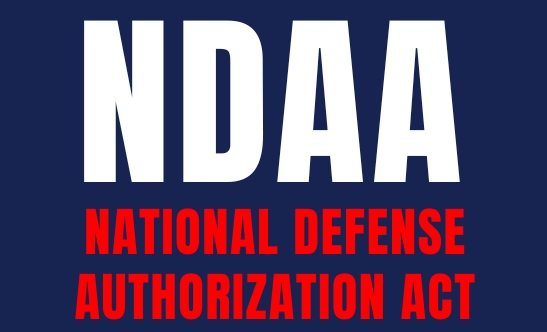

{alt="" width="30%" fig-align="center"}

The [National Defense Authorization Act (NDAA) for 2026](https://www.congress.gov/bill/119th-congress/senate-bill/1071/text) only had one major UAS related update. It created a new statutory carveout allowing state, local, and tribal law enforcement and correctional agencies to deploy counter-UAS technology under defined conditions, removing long-standing federal prohibitions that previously limited non-federal action.

Once certified, agencies are exempt from statutes such as the Wiretap Act and 18 U.S.C. Section 32, which otherwise prohibit interference with or destruction of aircraft in flight, when acting under this authority. Certified agencies may take actions deemed necessary to mitigate a credible threat posed by an unmanned aircraft system to:

- Public safety
- Facilities and assets
- Large-scale public events and venues
- Critical infrastructure
- Correctional facilities

To qualify for this authority, agencies must:

- Receive counter-UAS training from the Department of Homeland Security
- Use counter-UAS systems approved by DHS and the Department of Defense
- DHS and DoD have six months to issue implementing regulations, establish the training program, and define the equipment approval process.

[← Back to Recent News](../../recent-news.qmd)
