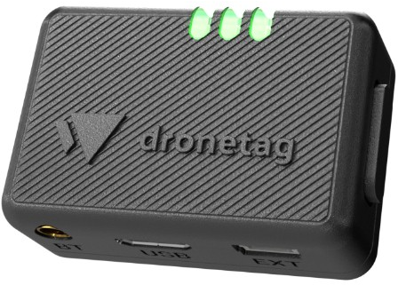

Remote ID is a system that broadcasts a drone's identity, location, and flight information while it is in the air, comparable to a digital license plate. The broadcast can be received by anyone with a compatible receiver, allowing nearby individuals and law enforcement to identify aircraft in the airspace.

For more information about Remote Identification, please visit the FAA's website [here](https://www.faa.gov/uas/getting_started/remote_id)

::: callout-note
Remote Identification functionality was required by March 16, 2024. Latest news - [FAA Extends Remote ID Enforcement Date Six Months](https://www.faa.gov/newsroom/faa-extends-remote-id-enforcement-date-six-months)
:::

## Ways to Comply

A drone must meet Remote ID requirements in one of three ways.

### Standard Remote Identification

Most drones manufactured after December 2022 have RID already built-in to the drone's firmware. Standard RID displays the drone's location, altitude and speed, as well as the location and altitude of it's operation station.

### Broadcast Remote Identification

For drones that don't have RemoteID built in, pilots must install a Remote ID broadcast module. This is a a small and lightweight component that can be added externally to a drone. It functions the same as standard remote identification, minus the ability to broadcast the location of the drone's operator. Modules can only display the location of the drone's takeoff point. Examples include the BlueMark DroneBeacon db120, the Dronetag Beacon, and the Spektrum SkyID (for RC aircraft).

{fig-alt="Image of the DroneTag Beacon Remote ID Broadcast module" width="30%" fig-align="center"}

### FAA Recognized Identification Area (FRIA)

For drones that do not have RID capabilities, the FAA is allowing pilots to fly their drones only in FAA Recognized Identification Areas. As of now, only Educational institutions and FAA-recognized Community Based Organizations can apply for a FRIA.

The Drone Map of California has been updated with all approved FRIAs in California: [Drone Map of California](https://ucdrones.github.io/map/).

## Updating your Registration

To complete the transition to Remote ID, all drone registrations must be updated on the FAA Drone Zone.

1.  Log into FAA Drone Zone
2.  From your dashboard, enter your drone inventory.\
3.  Find the drone registration you want to update, and click the three vertical dots to open the menu.
    - Select 'Edit' from the dropdown menu.
4.  In the new window, when it asks 'Does your drone broadcast FAA Remote ID information?' select 'YES.'
5.  Update your UAS TYPE - the options will change when you select 'YES'
    - Select either 'Standard Remote ID' or 'Remote ID Broadcast Module'
6.  Enter in the Remote ID Serial Number
    - If your drone has Remote ID built-in (ie, Standard Remote ID), use your drone's serial number.
    - If you are adding a Remote ID Broadcast Module, use the Remote ID Broadcast Module's serial number.

## Frequently Asked Questions

**Is compliance mandatory?** Yes. Remote ID is required by federal regulation and enforced by the FAA. Failure to comply is a violation of University policy and may result in disciplinary action.

**Should I choose a Standard Remote ID drone or a broadcast module?** Standard Remote ID is simpler and does not carry the added visual-line-of-sight condition that applies to broadcast modules. A module is a practical option for an existing drone that lacks built-in capability.

**After installing a module, is further configuration required?** Within the US, typically not, beyond updating the registration. Additional configuration may be needed if the drone will be used internationally.

**How do I read Remote ID broadcasts?** See [Reading Remote ID](remote-id-reading.qmd).
